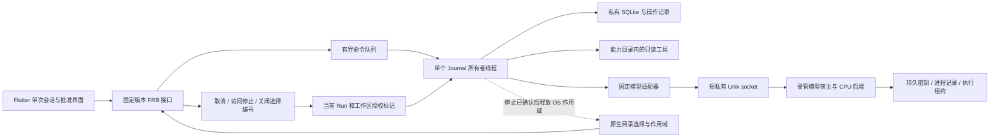

# 本地 Agent 执行接口与验证边界

2026-11-08。此切片实现 Rust Host、生成的 Flutter/FRB 接口和单次会话/工具批准界面。固定本地模型的导入与受管启动/停止已接入，完整模型管理与孤儿恢复尚未完成，不据此标记完整桌面 Agent 完成。当前界面连接已配置的本地服务；真实模型 API 验收与沙箱 UI 的模型协议替身验收分别记录。

## 所有权与并发

一个专用线程持有一个 SQLite Journal 和 current-thread Tokio runtime；有界队列最多等待 32 个任务，超限返回 `HOST_BUSY`。公开会话注册表只用于查找不透明句柄和投递任务，不在模型网络等待期间持锁。不通过第二个 SQLite 写者绕过独占锁，也不为 Journal 增加 unsafe Sync。

撤权与取消先通过注册表中的原子撤销标记/watch 通道打断当前执行，再排队提交持久状态。取消某个 Run 使用独立的 Run grant，不撤销整个工作区的用户同意。工作区撤权使用共享 WorkspaceRevoker，覆盖所有关联 Run。成功响应代表对应持久操作已提交；信号发出本身不是持久撤权确认。

关闭 Host 立即作废句柄并广播取消；晚到的响应不能再返回内容。所有者线程退出时关闭 Journal 并释放锁。立即重开遇到旧所有者尚未排空时返回 `HOST_BUSY`，调用者可有界重试。关闭不表示 GPU、Job 或外部模型进程已回收。线程退出/异常同样作废会话并触发撤销信号。

工作区访问区分持久同意和本次 OS 访问。WorkspaceView 新增 `sessionToken`；`suspendWorkspaceAccess(handle, workspaceId, sessionToken)` 停止对应当前访问，但不撤销持久同意。旧 token 不得停止替代它的新访问。进行中的 Run 被打断；已完成记录只有在重新取得系统访问并完成来源校验后才可再展示，unknown 隔离不被清除。

UI 使用更早可知的系统选择编号：`suspendWorkspaceSelection(handle, requestId)` 在授权响应丢失或仍排队时也能关闭该选择。授权发布与关闭标记在同一控制锁下检查，关闭后拒绝该编号的延迟授权；旧编号不能撤销已经更换编号的访问。每个 Host 达到 8192 个关闭标记后拒绝新授权，仍允许最多 32 个现有活动工作区收尾。只有 Rust 确认停止访问（或整个 Host 已关闭）后才释放对应原生 OS scope。重新选择必须使用新的系统选择编号。

## FRB 接口

全部命令要求当前 `handle`，失败只返回安全错误码和关联 ID。目录路径及模型配置只能由可信 UI/模型管理层提供，不能接受模型输出作为权限。

| 接口 | 输入与结果 | 关键约束 |
| --- | --- | --- |
| `connectLocalModel` | 私有服务目录 → ModelConnectionView | 目录必须在 Host 私有存储内；验证 profile/process/api.key 的文件类型、权限、大小与一致性，检查私有 socket 健康及实例未变 |
| `disconnectLocalModel` | handle → 空 | 清除连接，不声称停止外部模型服务 |
| `startRun` | workspaceId/requestId/prompt → AgentRunView | 本次会话目录访问已恢复、已配置模型；相同请求幂等，改变提示词或工作区返回冲突 |
| `startInteractiveRun` | workspaceId/requestId/prompt → AgentRunView | 创建时显式启用问答；其余约束同startRun；不能给已有普通Run追加能力 |
| `answerUserQuestion` | runId/questionId/expectedDigest/answers → AgentRunView | 原问题/摘要绑定、答复字节与数量、当前权限和来源重验；同答复幂等、异参冲突；不批准工具、不调用模型 |
| `inspectRun` | runId → AgentRunView | 所有者、当前 grant 及已读取源数据必须重新授权；源删除/变化不展示缓存最终答案 |
| `approveTool` | runId/operationId/expectedDigest → AgentRunView | 比对不可变操作和参数摘要；批准期限至多 60 秒且不超过 Run 截止时间；不由 advance 自动批准 |
| `advanceRun` | runId/expectedRevision → AgentRunView | 版本不匹配不执行；必须保持模型身份一致；执行后有内容时再次校验来源 |
| `cancelRun` | runId → AgentRunView | 只需有效句柄及所属 Run，不依赖仍可访问源目录；保留已完成历史但隐藏最终内容 |

AgentRunView 包含 run/workspace/model 身份、phase、revision、steps、invocations、待批准操作、可空的 userQuestion、finalText 和 failure。参数预览是 JSON 文本，不是授权请求的可修改副本。列表 `listRuns` 保持只含元数据，不能通过历史列表绕过来源校验。

当前每个 Host 会话最多保留 256 个 Run 上下文；单 Run 默认 30 步、20 次模型调用、每次最多 256 输出 token、15 分钟截止时间，提示词上限 64 KiB。这些是本地开发限额，不是计费认证。

`MODEL_NOT_CONFIGURED` 不创建占位 Run。`MODEL_CONTEXT_CHANGED` 阻止旧 Run 隐式切换模型。`TOOL_PREVIEW_CHANGED` 拒绝过期或被修改的参数预览。`RUN_SOURCE_UNAVAILABLE` 不退回原始未经授权的 Journal 视图。`WORKSPACE_RECOVERY_REQUIRED` 保留 unknown 调用隔离，取消不将未知调用变成可安全重放。

## 本地模型连接

当前只连接 CPU llama.cpp 私有 Unix socket，Windows 明确返回传输不可用。模型 ID 来自模型别名、上下文长度、模型文件及可执行文件摘要的规范化摘要。后端请求将内部身份映射为服务别名；后端只生成候选响应，不能执行工具。

实测沙箱应用支持目录下的 socket 路径为 117 字节、私有临时目录下为 81 字节；因此服务配置支持可选 `socket_directory`。配置、密钥、执行租约与进程记录仍必须在 Host 私有存储，短 IPC 目录仅放 socket 和服务端监督器的非秘密状态目录绑定。连接时先预留短目录为受保护目录，再连接；不接受任意 HTTP URL。监督器拒绝其他状态目录复用端点，并在 inode 被替换时拒绝删除或宣称回收。

macOS 声明网络客户端能力以连接本机服务，App Sandbox 和只读用户选择权限仍保留。模型服务子进程不能依赖 UI 启动后取得的工作区权限；模型权重与配置必须由应用安装到它自己的存储。[Apple App Sandbox 权限与继承](https://developer.apple.com/library/archive/documentation/Miscellaneous/Reference/EntitlementKeyReference/Chapters/EnablingAppSandbox.html)

连接显示 `local-development-configuration`：这是私有配置和健康检查，不是生产模型审批、二进制远程证明或生命周期所有权。默认界面的服务所有权、停止、重开与 App Sandbox 链路见[受管模型服务](managed-model-service.md)；仍不允许凭外部进程记录接管或杀掉未知进程。模型密钥不通过 FRB 返回，也不能放在用户授权工作区。

## 验证方式

`python3 scripts/check-bridge.py --native`：8 项 Rust 测试（其中一项覆盖整个 actor 并发、响应丢失、排队授权与恢复流程）、Clippy、固定生成物、Dart 静态分析、14 项界面测试和3项真实 macOS Flutter/FRB/SQLite 集成。并发模型与界面单测的命令端均为明确替身。原生会话测试使用沙箱内的真实私有 Unix socket、真实 Rust/SQLite/文件工具与模型协议替身，实际点击批准后才向第二次模型请求提供文件内容；删除源文件后重新查看必须隐藏结果。原生选择器回调也是明确替身，不能替代人工 OS 选择或真实模型管理认证。

`scripts/check-real-run.py` 是单独的真实模型验收，需要显式给出 `--model-lock`、`--build-manifest`、`--model`、`--backend`、`--model-host`。普通构建不搜索相邻仓库。驱动校验已存在模型与 CPU 后端摘要，创建隔离目录和唯一内容，启动私有服务并持续保活，调用 `run-acceptance` 示例完成批准、真实读取、最终内容匹配、重开不重放、删除源后拒绝及取消。结束时关闭父控制通道并验证服务 stopped。仅测试驱动批准自身 fixture 的 `proof.txt` 读取或根目录列举，产品代码没有自动批准入口。

真实结果保存在 `.local/real-run/last-report.json`，不保存模型密钥、用户目录内容或提示词。该结果证明桌面 Rust Host API 与真实 CPU 模型闭环，不能替代 Flutter 模型页面、App Sandbox socket 访问、正式签名、GPU、Windows/Linux 或计费验证。

## 当前界面行为

工作区 scope 拥有者与会话面板保持同时挂载，查看历史不释放权限。新建 Run 的原编号和原提示词在创建响应未知时被冻结；核对时只重发同一幂等请求。自动推进停在每个工具请求，展示不可编辑的参数和摘要；当前只支持明确的读取/列目录批准，未来未知工具不能继承只读批准按钮。停止按钮在模型等待期间可用；停止、撤权、重新查看和应用转入后台会清除现有结果/工具预览并丢弃晚到的旧响应；用户输入的任务草稿不在这项清理中。恢复查看不自动推进或重放 unknown。

界面显示的是单次 Run 与最终结果，尚未实现完整多轮会话编辑、流式事件/分页、成果工作台、完整模型目录管理及作业级崩溃恢复。这些仍属于后继目标，不能用当前页面或替身测试替代。

## 问答状态

`UserQuestionGroupView`含questionId、argumentDigest和1—3个问题；每个`UserQuestionView`含prompt及可空choices。choices只提供建议，仍允许自行填写。每题回答最多4096 UTF-8字节；选择建议不会提交，所有问题均填写后才可提交。

`awaiting_user`会停止UI自动推进。答复提交成功后，原模型可用时才继续；后续文件工具依然要求逐操作批准。断开模型连接不阻止提交合法答复。查询/恢复及答复重新验证来源；暂停工作区访问或停止受管模型也会关闭等待中的问题。界面隐藏、撤权、取消和更换问题会清除未提交草稿，迟到响应不能恢复旧内容。详见[问答能力](user-questions.md)。

### 模型调用的中断记录

会话进入“需要核对未确认的执行”后，可点“核对模型派发记录”。桌面从原所有者的运行日志读取调用编号及已观测的原因。若运行时记录了计时，界面显示实际等待时长和当时的上限；宿主重开时才发现的派发只有发现时间。查询记录和重新打开界面不会再次请求模型。较早的日志可能仅有通用恢复状态。

适配器给出了有界错误分类时，“核对模型派发记录”也显示相应的接口状态、协议、额度或回复完整性信息。未确认派发仍保留原调用编号。
